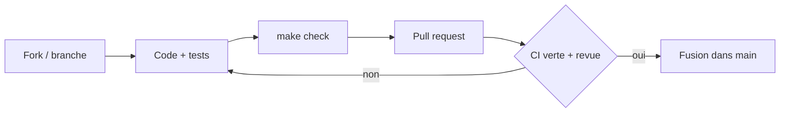

# Contribuer à FBtools

Merci de votre intérêt ! Ce guide décrit comment proposer une modification.

## Sommaire

- [Code de conduite](#code-de-conduite)
- [Signaler un bug ou proposer une idée](#signaler-un-bug-ou-proposer-une-idée)
- [Environnement de développement](#environnement-de-développement)
- [Flux de travail](#flux-de-travail)
- [Conventions](#conventions)
- [Tests](#tests)
- [Publier une version](#publier-une-version)

## Code de conduite

Ce projet applique le [Code de conduite](CODE_OF_CONDUCT.md). En participant, vous vous engagez à le respecter.

## Signaler un bug ou proposer une idée

- **Bug** : ouvrez une issue avec le modèle « Signaler un bug ».
- **Fonctionnalité** : utilisez le modèle « Proposer une fonctionnalité ».
- **Faille de sécurité** : ne créez pas d'issue publique, suivez [SECURITY.md](SECURITY.md).

> Ne publiez jamais de jeton d'accès, de secret d'app ou de donnée personnelle de vos Pages.

## Environnement de développement

Prérequis : Python 3.10 ou plus, Git, `make` (facultatif).

```bash
git clone https://github.com/teremuhamblin/FBtools.git
cd FBtools
python -m venv .venv && source .venv/bin/activate   # Windows : .venv\Scripts\activate
make install        # pip install -e ".[dev,docs]" + hooks pre-commit
make check          # lint + format + typage + tests
```

Commandes utiles :

| Commande | Effet |
| --- | --- |
| `make lint` | Ruff (lint) |
| `make format` | Formate le code avec Ruff |
| `make typecheck` | Mypy en mode strict |
| `make test` | Pytest + couverture (seuil 80 %) |
| `make docs` | Sert la documentation en local (`http://127.0.0.1:8000`) |
| `make build` | Construit wheel et sdist dans `dist/` |

## Flux de travail



1. Créez une branche depuis `main` : `feat/…`, `fix/…`, `docs/…`, `chore/…`.
2. Faites des commits petits et ciblés.
3. Ajoutez une entrée dans `CHANGELOG.md` sous « Non publié ».
4. Ouvrez une pull request en remplissant le modèle.

## Conventions

- **Commits** : [Conventional Commits](https://www.conventionalcommits.org/fr/) — `feat:`, `fix:`, `docs:`, `test:`, `refactor:`, `chore:`, `ci:`.
- **Style** : Ruff (lint + format), lignes de 100 caractères.
- **Typage** : annotations obligatoires, `mypy --strict` doit passer.
- **Langue** : messages de l'interface et documentation en français.
- **Versions** : [SemVer](https://semver.org/lang/fr/).

## Tests

Les tests n'utilisent **jamais le réseau** : la session HTTP est simulée (`tests/conftest.py`) et les commandes CLI utilisent un client factice (`tests/test_cli_commands.py`).

- Toute nouvelle commande doit être testée via `CliRunner`.
- Tout nouvel appel d'API doit être testé avec `FakeSession`.

## Publier une version

Réservé aux mainteneurs :

1. Mettez à jour la version dans `pyproject.toml` et `src/fbtools/__init__.py`.
2. Déplacez les entrées « Non publié » du `CHANGELOG.md` vers la nouvelle version.
3. `git tag vX.Y.Z && git push --tags` : le workflow **Release** construit le paquet, crée la release GitHub, publie l'image Docker sur GHCR et, si la variable `PUBLISH_PYPI` vaut `true`, publie sur PyPI.
