<a id="top"></a>

<div align="center">

<picture>
  <source media="(prefers-color-scheme: dark)" srcset="assets/banner-dark.svg">
  <source media="(prefers-color-scheme: light)" srcset="assets/banner-light.svg">
  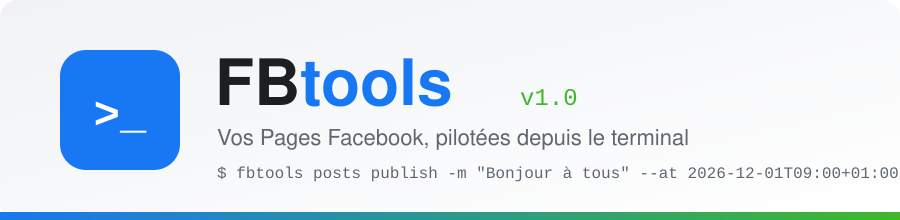
</picture>

<br>


### $\color{#1877F2}{\textsf{CLI Python pour gérer vos Pages Facebook via l'API Graph de Meta}}$

<sub><samp>publier · programmer · supprimer · exporter · mesurer — sans quitter le terminal</samp></sub>

[**Installation**](#installation) &nbsp;•&nbsp; [**Démarrage rapide**](#démarrage-rapide) &nbsp;•&nbsp; [**Commandes**](#référence-des-commandes) &nbsp;•&nbsp; [**Architecture**](#architecture) &nbsp;•&nbsp; [**Développement**](#développement)

</div>

---

## Sommaire

<details open>
<summary><b>Afficher / masquer le sommaire</b></summary>

1. [Aperçu](#aperçu)
2. [Fonctionnalités](#fonctionnalités)
3. [Installation](#installation)
4. [Prérequis Meta](#prérequis-meta)
5. [Démarrage rapide](#démarrage-rapide)
6. [Référence des commandes](#référence-des-commandes)
   - [Configuration](#configuration)
   - [Pages et identité](#pages-et-identité)
   - [Publications](#publications)
   - [Commentaires](#commentaires)
   - [Insights](#insights)
7. [Formats de sortie](#formats-de-sortie)
8. [Variables d'environnement](#variables-denvironnement)
9. [Architecture](#architecture)
   - [Vue d'ensemble](#vue-densemble)
   - [Cycle d'une publication](#cycle-dune-publication)
   - [Pagination automatique](#pagination-automatique)
   - [Limites de débit et backoff](#limites-de-débit-et-backoff)
10. [Structure du projet](#structure-du-projet)
11. [Développement](#développement)
12. [Notes et bonnes pratiques](#notes-et-bonnes-pratiques)
13. [Licence](#licence)

</details>

---

## Aperçu

> [!TIP]
> **FBtools** remplace les allers-retours dans l'interface Meta Business Suite par des commandes courtes, scriptables et versionnables. Idéal pour l'automatisation (cron, CI) et l'export de données.

<table>
<tr>
<td width="33%" valign="top">

#### $\color{#1877F2}{\textsf{Publier}}$
Publication immédiate ou **programmée** (`--at`), avec `--dry-run` et confirmation interactive.

</td>
<td width="33%" valign="top">

#### $\color{#42B72A}{\textsf{Exporter}}$
Tous les commentaires d'une publication en **CSV / JSON**, pagination gérée automatiquement.

</td>
<td width="33%" valign="top">

#### $\color{#F7B928}{\textsf{Mesurer}}$
Statistiques de Page avec **métriques configurables**, périodes et plages de dates.

</td>
</tr>
</table>

<p align="right"><a href="#top">↑ Retour en haut</a></p>

---

## Fonctionnalités

| Commande | Rôle | Type |
| :--- | :--- | :---: |
| `fbtools config set-token / set-page / set-version / show` | Configuration locale (fichier `chmod 600`) |  |
| `fbtools whoami` | Identité du jeton et permissions accordées |  |
| `fbtools pages list` | Pages administrées |  |
| `fbtools posts list` | Dernières publications d'une Page |  |
| `fbtools posts publish` | Publier ou **programmer** (`--at`), avec `--dry-run` et confirmation |  |
| `fbtools posts delete` | Supprimer une publication |  |
| `fbtools comments export` | Export CSV/JSON de tous les commentaires (pagination automatique) |  |
| `fbtools insights` | Statistiques de Page (métriques configurables) |  |

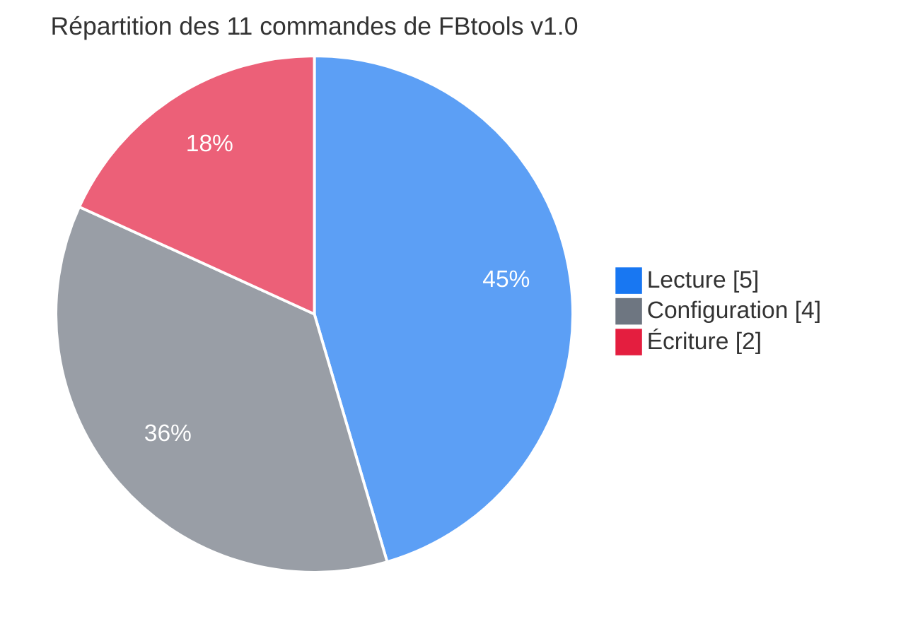

**Points techniques**

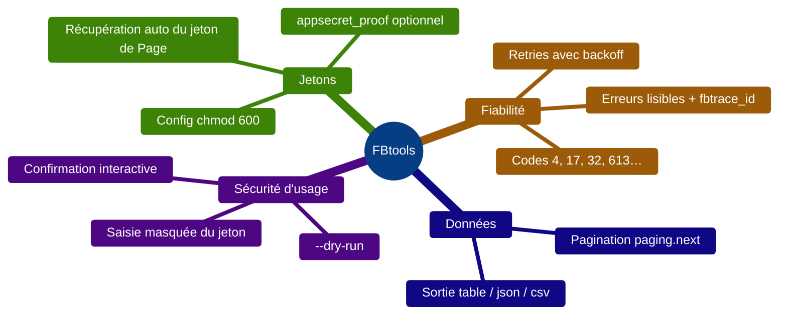

<p align="right"><a href="#top">↑ Retour en haut</a></p>

---

## Installation

```bash
cd fbtools
python -m venv .venv && source .venv/bin/activate
pip install -e ".[dev]"
fbtools --help
```

<details>
<summary><b>Windows (PowerShell)</b></summary>

```powershell
cd fbtools
python -m venv .venv
.venv\Scripts\Activate.ps1
pip install -e ".[dev]"
fbtools --help
```

</details>

<p align="right"><a href="#top">↑ Retour en haut</a></p>

---

## Prérequis Meta

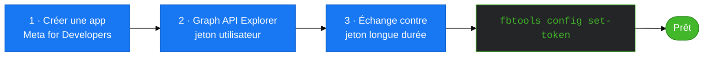

1. Créez une app sur [Meta for Developers](https://developers.facebook.com/apps/).
2. Générez un jeton utilisateur (Graph API Explorer) avec les permissions ci-dessous.
3. Pour un usage durable, échangez-le contre un **jeton longue durée**.

| Permission | Nécessaire pour |
| :--- | :--- |
|  | `pages list`, récupération du jeton de Page |
|  | `posts list`, lecture des Pages |
|  | `posts publish`, `posts delete` |
|  | `insights` |
|  | `comments export` |

> [!IMPORTANT]
> Ne commitez jamais votre jeton. Utilisez `fbtools config set-token` (saisie masquée, fichier `chmod 600`) ou la variable `FBTOOLS_ACCESS_TOKEN`.

<p align="right"><a href="#top">↑ Retour en haut</a></p>

---

## Démarrage rapide

```bash
fbtools config set-token                  # saisie masquée
fbtools whoami                            # vérifie identité et permissions
fbtools pages list                        # liste vos Pages
fbtools config set-page 1234567890        # définit la Page par défaut
```

$\color{#42B72A}{\texttt{✔ Configuration terminée — vous pouvez publier.}}$

<p align="right"><a href="#top">↑ Retour en haut</a></p>

---

## Référence des commandes

### Configuration

```bash
fbtools config set-token          # enregistre le jeton (saisie masquée)
fbtools config set-page <PAGE_ID> # Page par défaut
fbtools config set-version v27.0  # version de l'API Graph
fbtools config show               # affiche la configuration courante
```

### Pages et identité

```bash
fbtools whoami
fbtools pages list -f json
```

### Publications

```bash
# Lister
fbtools posts list -n 10 -f csv > posts.csv

# Publier immédiatement
fbtools posts publish -m "Bonjour à tous" --link https://exemple.fr

# Programmer depuis un fichier, sans confirmation
fbtools posts publish --message-file annonce.txt --at 2026-12-01T09:00+01:00 -y

# Supprimer
fbtools posts delete <POST_ID>
```

> [!NOTE]
> `--dry-run` affiche la requête qui serait envoyée sans rien publier. Sans `-y`, une confirmation est demandée avant toute écriture.

### Commentaires

```bash
fbtools comments export 1234567890_987654321 -o commentaires.csv
```

### Insights

```bash
fbtools insights --period day --since 2026-11-01 --until 2026-11-25
fbtools insights --metric <METRIQUE> -f json
```

<p align="right"><a href="#top">↑ Retour en haut</a></p>

---

## Formats de sortie

Toutes les commandes de lecture acceptent `-f table|json|csv`.

| Option | Rendu | Usage conseillé |
| :---: | :--- | :--- |
| <kbd>-f table</kbd> | Tableau lisible | Consultation dans le terminal |
| <kbd>-f json</kbd> | JSON structuré | Scripts, `jq`, intégrations |
| <kbd>-f csv</kbd> | CSV | Tableurs, analyses de données |

<p align="right"><a href="#top">↑ Retour en haut</a></p>

---

## Variables d'environnement

Les variables d'environnement sont **prioritaires** sur le fichier de configuration.

| Variable | Rôle |
| :--- | :--- |
| `FBTOOLS_ACCESS_TOKEN` | Jeton d'accès |
| `FBTOOLS_APP_SECRET` | Secret d'app (active `appsecret_proof`) |
| `FBTOOLS_API_VERSION` | Version de l'API Graph |
| `FBTOOLS_CONFIG_DIR` | Répertoire du fichier de configuration |

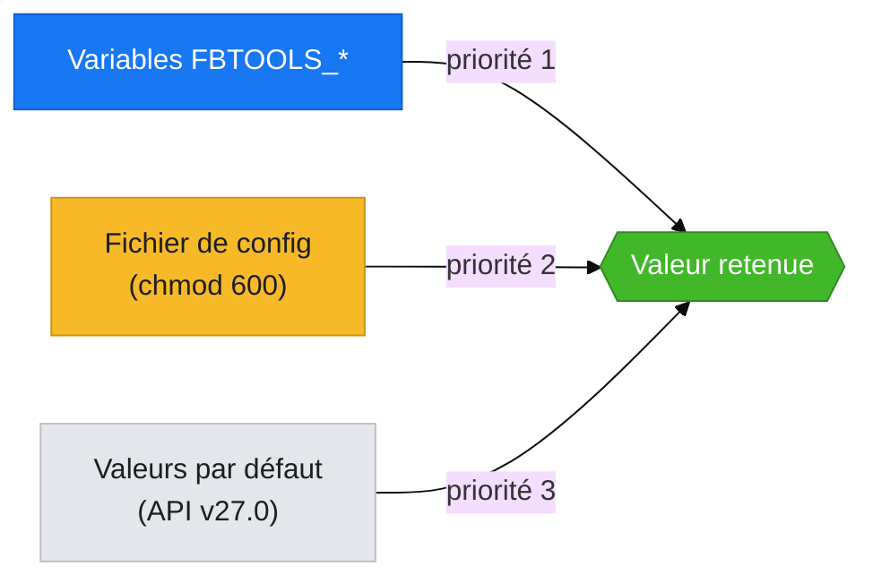

<p align="right"><a href="#top">↑ Retour en haut</a></p>

---

## Architecture

### Vue d'ensemble

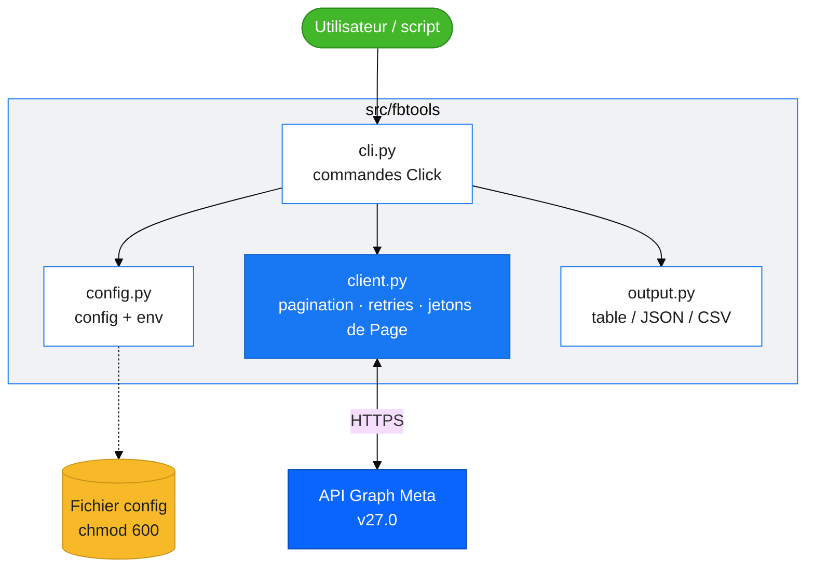

### Cycle d'une publication

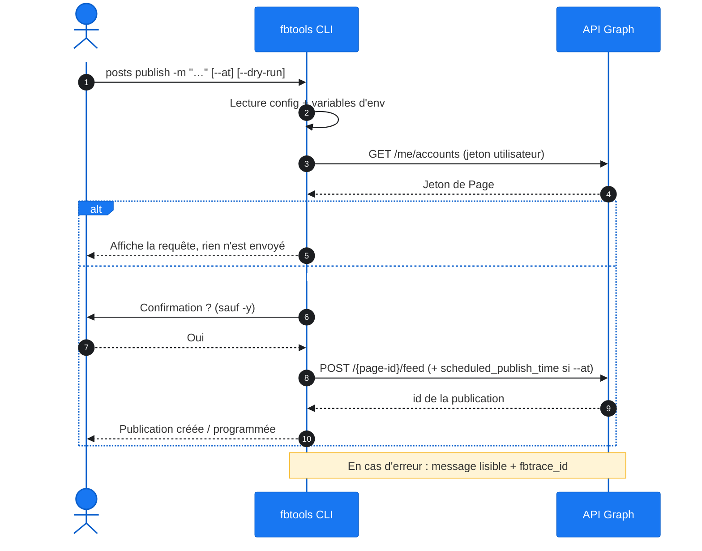

### Pagination automatique

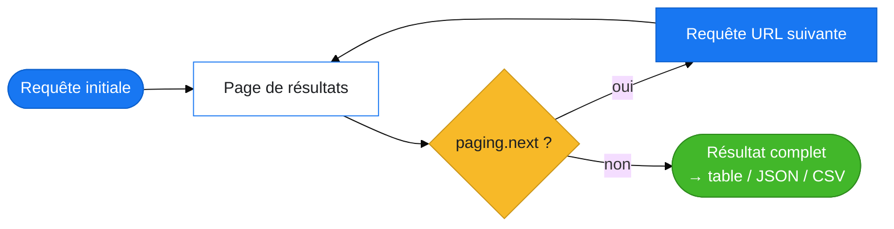

### Limites de débit et backoff

Lorsque l'API renvoie un code de limitation (**4, 17, 32, 613…**), FBtools réessaie automatiquement avec un délai croissant.

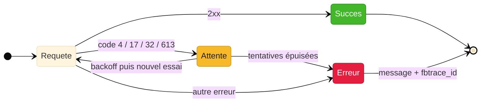

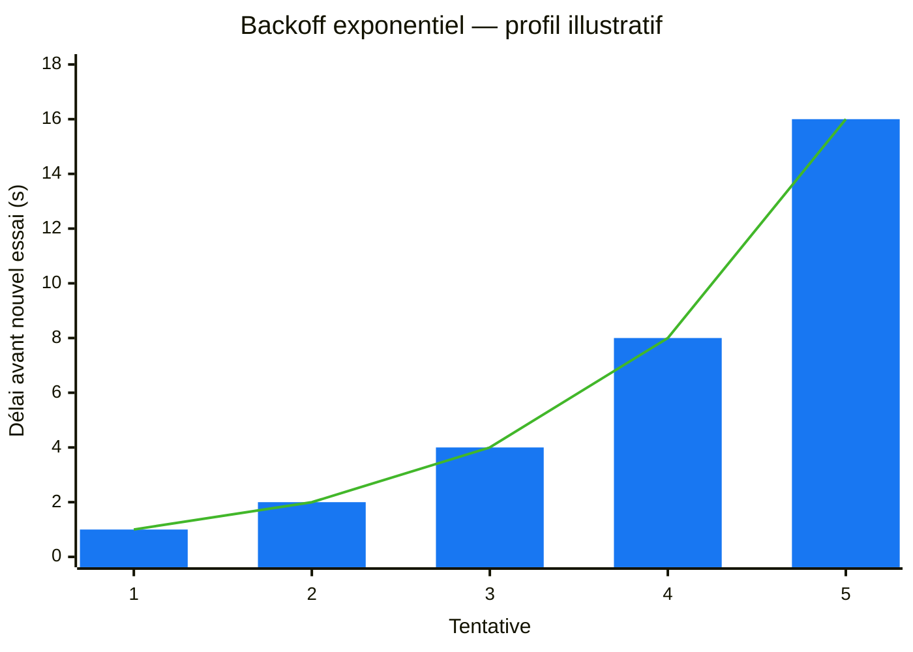

<sub>Graphique illustratif du principe ; les délais et le nombre de tentatives réels sont définis dans <code>client.py</code>.</sub>

<p align="right"><a href="#top">↑ Retour en haut</a></p>

---

## Structure du projet

```text
fbtools/
├── pyproject.toml
├── src/fbtools/
│   ├── __init__.py   # version, version d'API par défaut
│   ├── cli.py        # commandes Click
│   ├── client.py     # client API Graph (pagination, retries, jetons de Page)
│   ├── config.py     # configuration locale + variables d'environnement
│   └── output.py     # rendu table / JSON / CSV
└── tests/
```

<p align="right"><a href="#top">↑ Retour en haut</a></p>

---

## Développement

```bash
pytest              # tests sans réseau (session HTTP simulée)
ruff check src tests
```

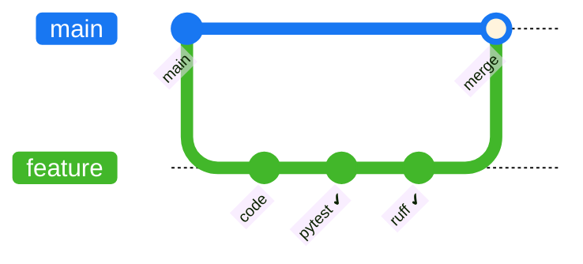

<p align="right"><a href="#top">↑ Retour en haut</a></p>

---

## Notes et bonnes pratiques

> [!WARNING]
> Certaines métriques Insights ont été retirées par Meta (ex. `page_impressions_unique`) ; utilisez `--metric` pour choisir les vôtres.

> [!CAUTION]
> Respectez les [Conditions de la plateforme Meta](https://developers.facebook.com/terms/) : FBtools n'utilise que l'API officielle.

---

## Licence

<div align="center">

Distribué sous licence **MIT**.

$\color{#1877F2}{\textsf{FB}}\color{#42B72A}{\textsf{tools}}$ &nbsp;<samp>v1.0</samp>

<a href="#top">↑ Retour en haut</a>

</div>
