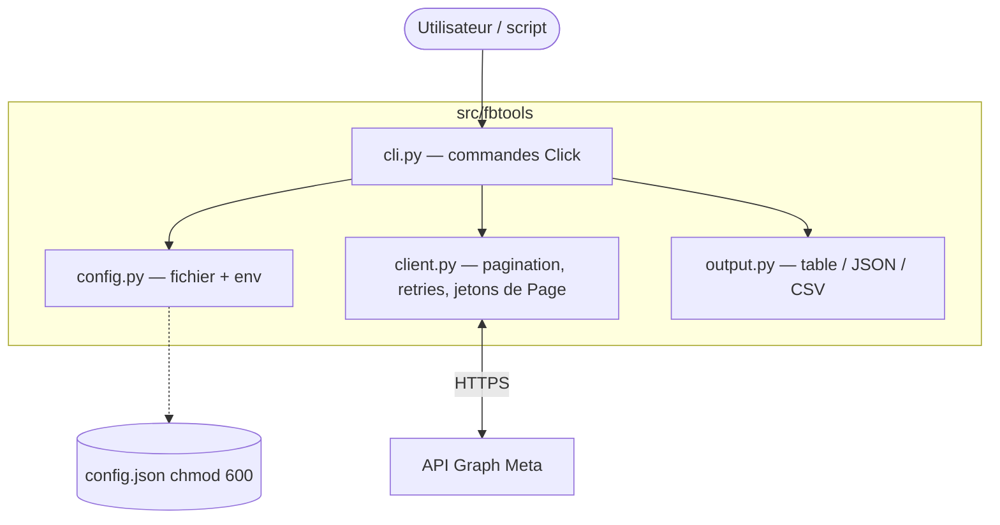
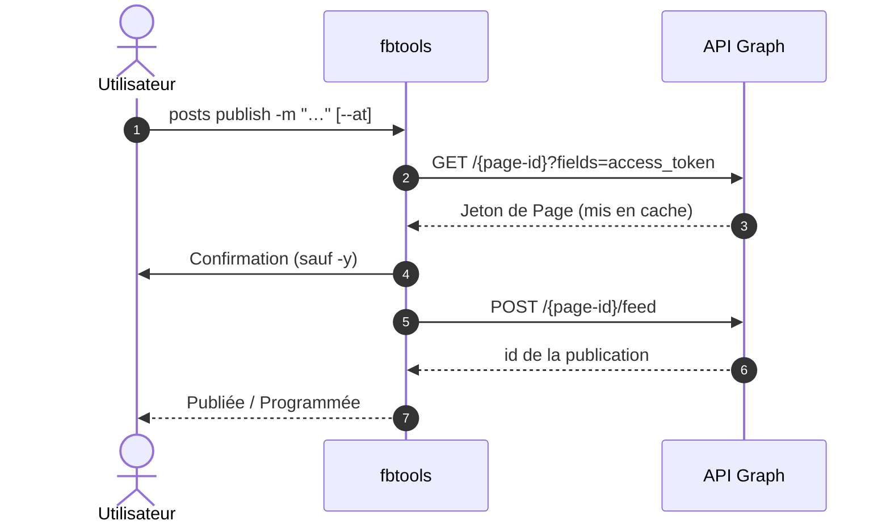
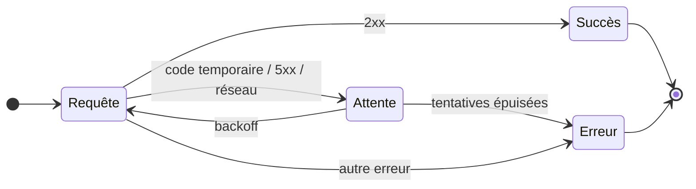

# Architecture

## Modules

| Module | Responsabilité |
| --- | --- |
| `__init__.py` | Version du paquet, version d'API par défaut |
| `cli.py` | Commandes Click, validation des entrées, codes de sortie |
| `client.py` | `GraphClient` : authentification, `appsecret_proof`, pagination, retries, cache des jetons de Page |
| `config.py` | Chargement/sauvegarde de la configuration, priorité des variables d'environnement |
| `output.py` | Aplatissement des objets imbriqués et rendu table / JSON / CSV |

## Cycle d'une publication

## Fiabilité

- **Nouvelles tentatives** sur les codes temporaires ou de limitation `1, 2, 4, 17, 32, 341, 613`, sur les erreurs HTTP 5xx et sur les coupures réseau.
- **Backoff exponentiel** : 1 s, 2 s, 4 s… plafonné à 30 s (`max_retries=3` par défaut).
- **Erreurs lisibles** : message, code, sous-code et `fbtrace_id` pour le support Meta.

