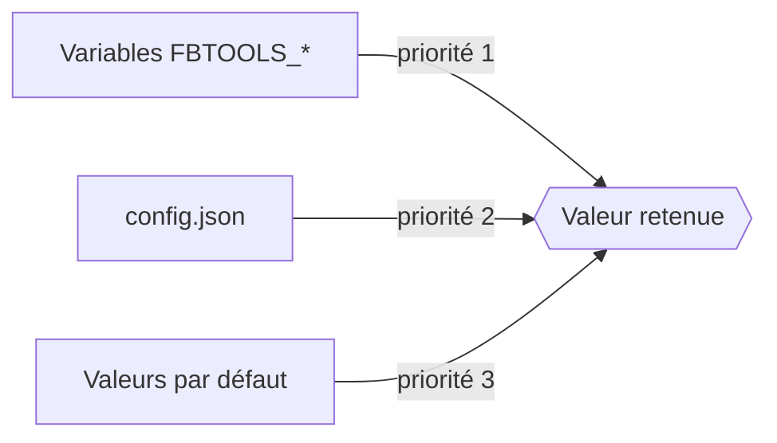

# Configuration

## Obtenir un jeton Meta

1. Créez une app sur [Meta for Developers](https://developers.facebook.com/apps/).
2. Ouvrez le [Graph API Explorer](https://developers.facebook.com/tools/explorer/) et générez un **jeton utilisateur**.
3. Accordez les permissions nécessaires :

| Permission | Commandes |
| --- | --- |
| `pages_show_list` | `pages list`, récupération du jeton de Page |
| `pages_read_engagement` | `posts list` |
| `pages_manage_posts` | `posts publish`, `posts delete` |
| `read_insights` | `insights` |
| `pages_read_user_content` | `comments export` |

4. Pour un usage durable, échangez-le contre un [jeton longue durée](https://developers.facebook.com/docs/facebook-login/guides/access-tokens/get-long-lived/).

## Enregistrer la configuration

```bash
fbtools config set-token                     # saisie masquée
fbtools config set-token --app-secret XXXX   # active appsecret_proof
fbtools config set-page 1234567890           # Page par défaut
fbtools config set-version v27.0             # version de l'API Graph
fbtools config show                          # secrets masqués
```

Le fichier est stocké dans `~/.config/fbtools/config.json` (ou `$XDG_CONFIG_HOME/fbtools/`) avec les droits `600`.

## Variables d'environnement

Elles sont **prioritaires** sur le fichier.

| Variable | Rôle |
| --- | --- |
| `FBTOOLS_ACCESS_TOKEN` | Jeton d'accès |
| `FBTOOLS_APP_SECRET` | Secret d'app (`appsecret_proof`) |
| `FBTOOLS_API_VERSION` | Version de l'API Graph |
| `FBTOOLS_CONFIG_DIR` | Répertoire du fichier de configuration |



!!! warning "Sécurité"
    Ne committez jamais un jeton. Un fichier `.env.example` est fourni : copiez-le en `.env` (ignoré par Git).
